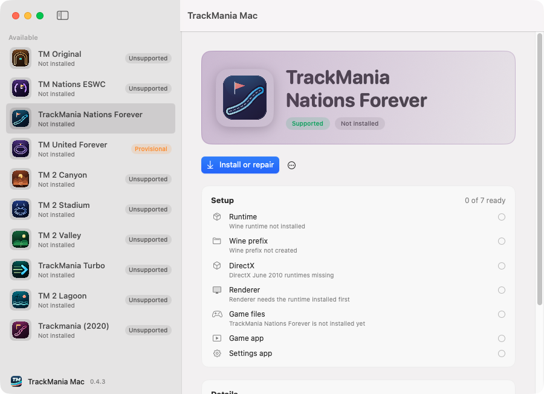
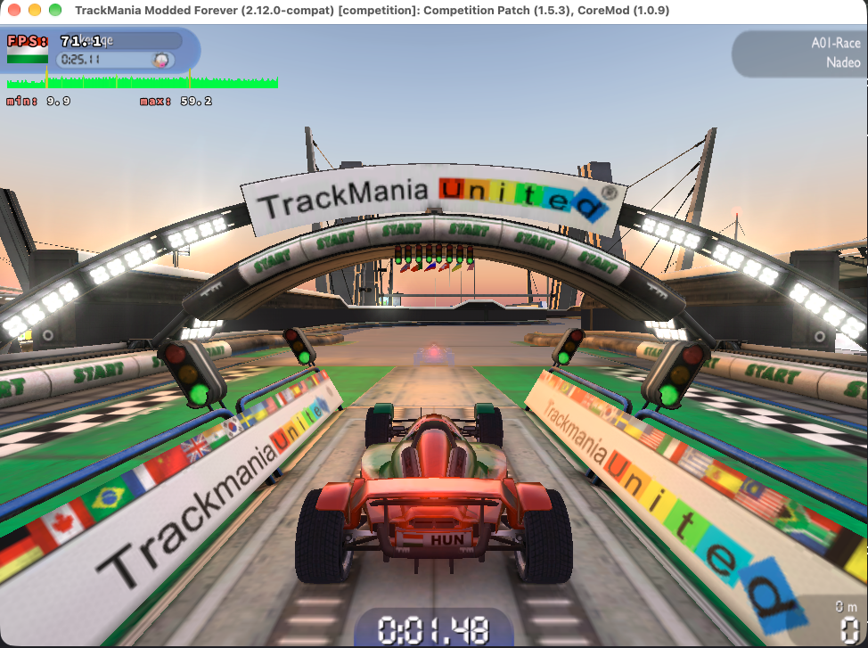
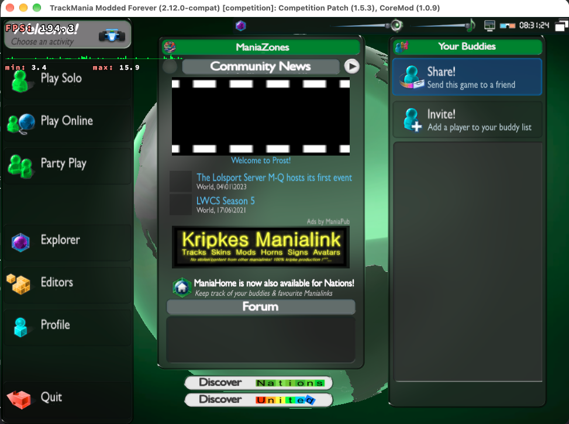

# TrackMania Mac

**Play TrackMania Nations Forever on an Apple Silicon Mac.** Download one free
app, click **Install**, and it sets up everything for you: the game, a patched
Windows compatibility layer (Wine), DirectX and the Competition Patch. You don't
need Windows, a virtual machine or developer tools.

**Website:** <https://vakesz.github.io/TrackMania-MacOS/> ·
**Download:** [latest release](https://github.com/vakesz/TrackMania-MacOS/releases/latest)



This is an independent community project, not affiliated with Nadeo or Ubisoft.
Games and Microsoft DirectX are downloaded from their original hosts or supplied
by you. They are not redistributed here.

> [!NOTE]
> Looking for Trackmania 2020? [Trackmania2020-MacOS](https://github.com/V-Roman-V/Trackmania2020-MacOS) is a separate community project, inspired by this one.  
> It isn't part of this hub for now, but it could be integrated later.

## What you need

- A Mac with Apple Silicon (M1 or later) running macOS 14 Sonoma or later.
  Intel Macs are not supported.
- An internet connection and a few gigabytes of free disk space.
- Rosetta 2. If it's missing, the installer adds it for you.

## Quick start

1. **Download** `TrackMania-Mac-<version>.app.zip` from the
   [latest release](https://github.com/vakesz/TrackMania-MacOS/releases/latest).
2. **Unzip it** and drag **TrackMania Mac.app** into your **Applications** folder.
3. **Open it.** If macOS says it can't verify the app, open
   **System Settings > Privacy & Security**, scroll down and click
   **Open Anyway**. You only have to do this once.
4. **Pick TrackMania Nations Forever** in the sidebar and click
   **Install or repair**. Choose **Download prebuilt (recommended)** when asked how to get the
   runtime. Downloading takes a few minutes; building it yourself takes hours.
5. **Play.** When the setup checklist is all green, click **Play** in the hub,
   or open **TrackMania Nations Forever** from your Applications folder.

The install adds two apps to your Applications folder:

| App | What it does |
| --- | --- |
| **TrackMania Nations Forever** | Starts the game with Competition Patch. Use this to play. |
| **TrackMania Settings** | Opens the game's own launcher to change graphics, resolution and audio. Close the game first, then save and close Settings before you play. |

### Your first launch

- Starting the game takes a while before a window appears. The window can open
  **behind other windows**, so check Mission Control or the Dock.
- The game shows its own **"Network check"** dialog. Click **OK**. The account
  screen comes next.
- The game opens in the display mode chosen in **TrackMania Settings**
  (fullscreen or windowed, at the resolution you pick). With more than one
  monitor, fullscreen uses the primary display.

| In game | Main menu |
| --- | --- |
|  |  |

Both screenshots are from an M1 Pro in a 1280x720 window with the DXVK frame
rate overlay enabled (`DXVK_HUD=fps,frametimes`).

## Which games work?

| Title | Where the game comes from | Status |
| --- | --- | --- |
| Nations Forever | free download from Nadeo | ✅ supported |
| United Forever | official retail installer (needs your serial key) | 🧪 provisional |
| Original | your own retail disc image or setup file | 🧪 provisional |
| TrackMania 2 Canyon | official ManiaPlanet trial | 🧪 provisional |
| Turbo | your existing Steam game folder | 🧪 provisional |

**Provisional** means the title installs, but graphics, copy protection, online
play and full gameplay have not been tested enough under Wine to call it
supported. See [the hub guide](docs/hub-app.md) for details.

## Common questions

**Is it free?** Yes. The hub and this project are free and open source.
Nations Forever is a free game.

**The game window doesn't show up.** Give it a minute, then look in Mission
Control or click the game in the Dock. Windows can open behind others.

**How do I change graphics settings?** Close the game, open
**TrackMania Settings**, change what you want, save, close it, then start the
game again. A new install starts with conservative settings (Nice shaders,
post-processing and stadium water geometry off, at most six opponents) so it
runs well on any Apple Silicon Mac.

**The first lap on a new track stutters.** The renderer builds its shader cache
the first time it sees a track, and later visits are smoother. See
[runtime fixes and troubleshooting](docs/runtime.md).

**Where are my saves and replays?** In `~/Games/TMNF/UserData/TmForever`. See
[where files go](#where-files-go) for everything else.

**How do I uninstall?** In the hub, select the game, click the **⋯** button and
choose **Uninstall…**. This removes the game's Wine prefix and keeps your saves,
the downloaded installers and the runtime.

**Something went wrong.** In the hub, click **⋯ > Open Logs Folder** and attach
the newest log when you
[open an issue](https://github.com/vakesz/TrackMania-MacOS/issues).

---

## For advanced users

Everything below is optional. The hub app above is all you need to play.

You'll need the Xcode command-line tools for `make`. Close any running
TrackMania session before you install or update.

### Install from a source checkout

From the repository root, this installs TMNF with the runtime chosen by
`RUNTIME`:

```sh
make install                  # auto: a local build if present, else download
make install RUNTIME=download # always the prebuilt release runtime
make install RUNTIME=build    # compile the runtime here, then install it
```

`make setup` takes the same `RUNTIME` choice. `build` has the prerequisites
listed under [Build the runtime yourself](#build-the-runtime-yourself). An
already installed runtime is never replaced.

To install from an archive you already downloaded instead, point the installer
at it and give the checksum from the release:

```sh
version="$(cat VERSION)"
TMNF_RUNTIME_ARCHIVE="$HOME/Downloads/trackmania-mac-${version}-runtime.tar.xz" \
TMNF_RUNTIME_SHA256="<checksum from the release>" make install
```

If macOS refuses to open the game after a manual download, the archive picked up
a quarantine flag in the browser. Clear it, then install:

```sh
version="$(cat VERSION)"
xattr -dr com.apple.quarantine "$HOME/Downloads/trackmania-mac-${version}-runtime.tar.xz"
```

Archives that `make install` fetches with `curl` are not quarantined, so this
step is only for a browser download.

The installed apps go in `/Applications` when it is writable, otherwise in
`~/Applications`. They use their installed support files, not the hub bundle or
a source checkout.

### Build the runtime yourself

This compiles the whole runtime from the pinned sources instead of downloading
it, then installs the game. Install [Homebrew](https://brew.sh) and the full
Xcode app, then select Xcode:

```sh
sudo xcode-select --switch /Applications/Xcode.app/Contents/Developer
make build
make install
```

Use a checkout path without spaces for source builds, as required by Wine's
makefiles. Installed games and runtime folders support spaces.

`make build` downloads pinned sources, verifies archive hashes and Git revisions,
applies the repository patches, then compiles Wine, D9VK, x87sidecar and the
session helper. It writes the complete runtime to `.build/release/runtime`.
Afterwards `make install` detects and installs that local runtime instead of
downloading one. `make install RUNTIME=build` does both steps, and in a hub
install it clones the commit that hub was built from (git comes with Xcode) into
`~/Library/Caches/TMNF/build`, builds there and deletes that folder after a
successful install. You need Apple Silicon, Rosetta 2, full Xcode and Homebrew
(missing formulae are installed with `brew install`). Allow several gigabytes
of disk space and a substantial first build. Builds use every CPU core by
default; use `TMNF_JOBS=4 make build` to leave some free.

The deployment target is macOS 14. x87sidecar also depends on the installed
Rosetta version; its compatibility probe must pass. See
[building and releasing](docs/building.md) for the tested host and limitations.

### Everyday commands

| Command | Action |
| --- | --- |
| `make play` | Start the same game as the app |
| `make diag` | Play with session diagnostics, then report frame rate by game state |
| `make report` | Show the report of the last diagnostic session again |
| `make configure` | Open the original settings launcher |
| `make doctor` | Check runtime, game, renderer, audio and mod installation |
| `make stop` | Stop Wine processes in this game's prefix |
| `make install` | Install missing files and refresh the app launchers |
| `./src/shell/cli/tmnf play-vanilla` | Run the official game without Competition Patch |
| `./src/shell/cli/tmnf uninstall` | Remove the Wine prefix after confirmation |

To force a fixed windowed size, set `TMNF_WINDOW_SIZE=1280x720` (any `WxH`).
That runs the game inside a separate Wine virtual desktop for this session.
Each dimension must be between 1 and 65535.

The session supervisor tracks both settings and game executables, so a launcher
exit alone does not authorize cleanup. Normal quits are quiet; failed or
uncertain sessions show an alert with the log location. Uncertainty does not
authorize killing a game that may still be running. Use `make stop` when you
explicitly want to stop the selected prefix.

### Where files go

| Files | Default location |
| --- | --- |
| Game and Wine prefix | `~/Games/TMNF/prefix` |
| Saves, settings and replays for a new install | `~/Games/TMNF/UserData/TmForever` |
| Runtime and installed launcher scripts | `~/Library/Application Support/TMNF` |
| Download cache | `~/Library/Caches/TMNF` |
| App launch logs | `~/Library/Logs/TMNF` |

Older local installations may still save to `~/Documents/TmForever`; the
installer keeps that existing arrangement. Uninstalling the prefix keeps the
runtime, download cache and separate user data.

To choose another game or app folder, set it when installing:

```sh
TMNF_ROOT="$HOME/Games/TrackMania" \
TMNF_APPS_DIR="$HOME/Applications" make install
```

The apps remember these installation paths. When using commands from the
checkout with a custom game folder, keep the same environment variables set.

App logs rotate before launch when they reach 2 MiB, retaining three numbered
backups. A currently running verbose session can exceed that size because game
output goes directly to a file, not a pipe that could interrupt a surviving game.

### Diagnostic overrides

`TMNF_X87=off make play` uses stock Rosetta math for a comparison.
`TMNF_AUDIO=off make play` disables sound. Normal installs enable both audio
and the patched translator. These temporary overrides do not change saved game
settings. `make install` replaces the game's Creative OpenAL with OpenAL Soft;
`TMNF_OPENAL=creative make install` puts the original back and keeps it on
later installs.

### How it works

The runtime is a patched Wine build with D9VK (Direct3D 9 to Vulkan), MoltenVK
(Vulkan to Metal) and x87sidecar, an x87 translator that preserves the game's
24-bit floating-point precision under Rosetta. The native hub bundles its own
Python runtime, so it needs no developer tools. See
[runtime fixes and troubleshooting](docs/runtime.md) for the patches.

### Development

`make check` runs shell checks, Ruff, mypy, Python tests, the CLI integration
test, SwiftLint and the Swift hub tests. Build, packaging, signing and release steps are in
[docs/building.md](docs/building.md); patch details are in
[docs/runtime.md](docs/runtime.md); contribution rules are in
[.github/CONTRIBUTING.md](.github/CONTRIBUTING.md). The project website lives in
[`website/`](website) and deploys to GitHub Pages on every push to `main` that
changes it.

Run `make smoke` only from a checkout with a built runtime and initialized
prefix, with Rosetta 2, Python 3 and network access for the HTTPS probe. Close
the game and Settings app first; audio checks need a working output device.

## License

This project's own scripts and tests use the MIT license. Patches and bundled
third-party code retain their upstream licenses. See [LICENSE](LICENSE) and the
`licenses` directory in each runtime archive. OpenAL Soft (LGPL 2.1 or later)
is downloaded from its official release during installation, not bundled; its
license is installed next to it in the game directory.

## Acknowledgements

This runtime is thin glue over other people's hard work. With gratitude to:

- [Wine](https://www.winehq.org) for the Windows compatibility layer everything here is built on.
- [DXVK](https://github.com/doitsujin/dxvk) and the [d9vk fork](https://github.com/Sikarugir-App/d9vk) that turn the game's Direct3D 9 calls into Vulkan.
- [MoltenVK](https://github.com/KhronosGroup/MoltenVK) for running Vulkan on Apple's Metal.
- [OpenAL Soft](https://openal-soft.org) for the game's audio mixing.
- Apple's Rosetta 2 for translating the game's x86 code on Apple Silicon.
- [athei](https://github.com/athei)'s [x87sidecar](https://github.com/athei/x87sidecar) and cooperative Wine handshake, which keep TMNF's 24-bit x87 math intact under Rosetta.
- [tomashu](https://tomashu.pages.dev)'s TMLoader, and the TrackMania Competition Patch and CoreMod that make online play current.
- GnuTLS, Nettle, GMP, libtasn1, libunistring, FreeType and mingw-w64, which the runtime links or is built with.
- Nadeo and Ubisoft for TrackMania Nations Forever itself.

Trademarks and game content belong to their owners. This is an unofficial community project, not affiliated with Nadeo or Ubisoft.
