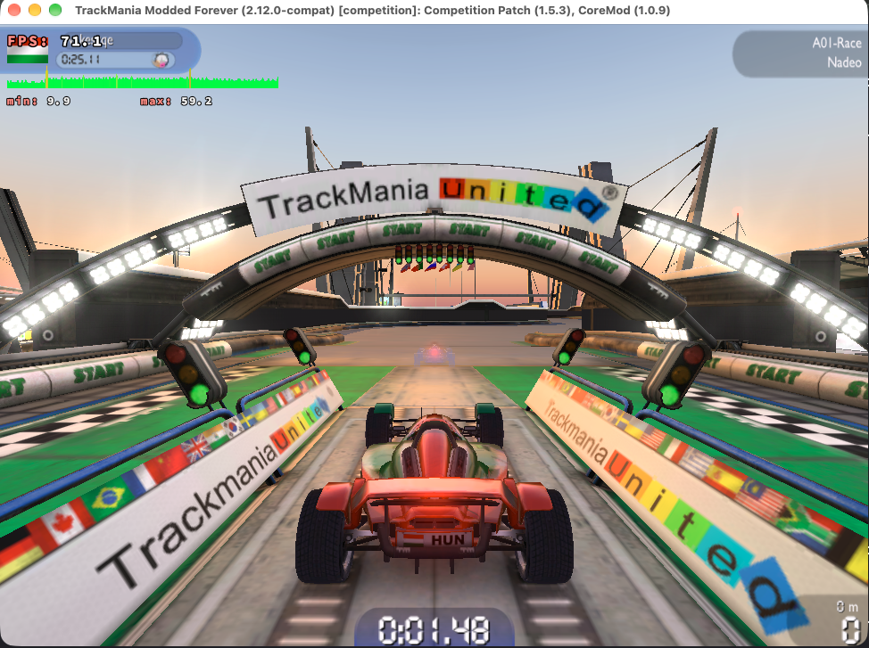
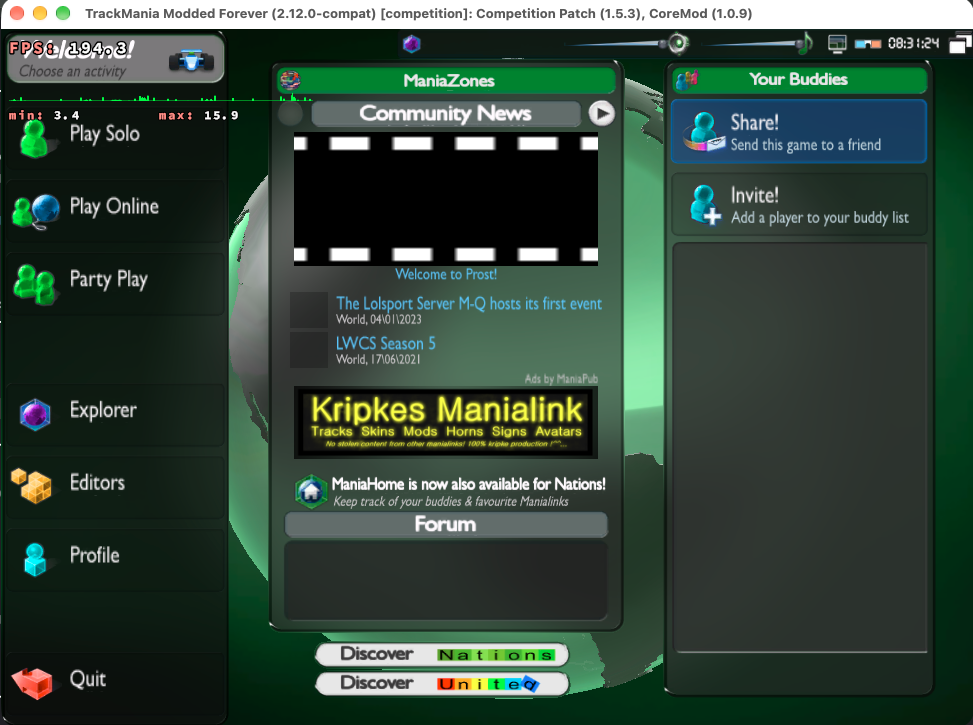

# TrackMania Nations Forever for Apple Silicon

Install TMNF with Competition Patch, working textures and audio, and a patched
Wine runtime tuned for this game. The runtime includes D9VK, MoltenVK and an
x87 translator that preserves the game's 24-bit floating-point precision.

This is an independent community project. The game and Microsoft DirectX are
downloaded from their original hosts during installation, not redistributed here.

| In game | Main menu |
| --- | --- |
|  |  |

Both screenshots are from an M1 Pro in a 1280x720 window with the DXVK frame
rate overlay enabled (`DXVK_HUD=fps,frametimes`).

## Requirements

An Apple Silicon Mac and an internet connection. Rosetta 2 is also required; the
installer adds it if necessary. The native hub bundles its own Python runtime, so
normal use needs no developer tools. A source checkout additionally needs the
Xcode command-line tools for `make`.

Close any existing TMNF session before installing or updating. Choose the native
hub download for normal use, or a checkout when building the runtime yourself.

## Option 1: native hub download

Download `TrackMania-Mac-<version>.app.zip` from
[GitHub Releases](https://github.com/vakesz/TrackMania-MacOS/releases), unzip it,
move the single **TrackMania Mac.app** to Applications, then open it. The native
hub shows every registered title and its install state. Nations Forever is the
supported game; United Forever and Canyon have pinned official installers, while
Original and Turbo use user-owned retail media or an existing Steam copy. Those
four entries are provisional and are not yet qualified for complete gameplay,
graphics or online services. See [the hub guide](docs/hub-app.md) for details.

For TMNF, it downloads the ready-built runtime, game, DirectX and Competition
Patch, then creates two separate apps:

- **TrackMania Nations Forever** starts the game with Competition Patch.
- **TrackMania Settings** opens the original launcher to change graphics and
  audio settings. Close the game before changing these settings.

Save and close the settings launcher, then use the game app to play with
Competition Patch.

The session supervisor tracks both settings and game executables, so a launcher
exit alone does not authorize cleanup. Normal quits are quiet; failed or
uncertain sessions show an alert with the log location. Uncertainty does not
authorize killing a game that may still be running. Use `make stop` when you
explicitly want to stop the selected prefix.

On the first launch the game shows its own "Network check" dialog for the
peer-to-peer firewall test; click OK. The account screen follows. A launch
takes a while to show a window; the game's windows may open behind others.

The two installed apps go in `/Applications` when it is writable, otherwise in
`~/Applications`. They use their installed support files, not the hub bundle or
a source checkout.

## Option 2: use a source checkout

From the repository root, this downloads the same prebuilt runtime and installs
TMNF:

```sh
make install
```

To install from an archive you already downloaded instead, point the installer
at it and give the checksum from the release:

```sh
version="$(cat VERSION)"
TMNF_RUNTIME_ARCHIVE="$HOME/Downloads/tmnf-${version}-runtime.tar.xz" \
TMNF_RUNTIME_SHA256="<checksum from the release>" make install
```

If macOS refuses to open the game after a manual download, the archive picked up
a quarantine flag in the browser. Clear it, then install:

```sh
version="$(cat VERSION)"
xattr -dr com.apple.quarantine "$HOME/Downloads/tmnf-${version}-runtime.tar.xz"
```

Archives that `make install` fetches with `curl` are not quarantined, so this
step is only for a browser download.

## Option 3: build the runtime yourself

This compiles the whole runtime from the pinned sources instead of downloading
it, then installs the game. Install [Homebrew](https://brew.sh) and the full
Xcode app, then select Xcode:

```sh
sudo xcode-select --switch /Applications/Xcode.app/Contents/Developer
make build
make install
```

Use a checkout path without spaces for source builds, as required by Wine's
makefiles. Installed games and runtime folders support spaces.

`make build` downloads pinned sources, verifies archive hashes and Git revisions,
applies the repository patches, then compiles Wine, D9VK, x87sidecar and the
session helper. It writes the complete runtime to `.build/release/runtime`.
Afterwards `make install` detects and installs that local runtime instead of
downloading one. Allow several gigabytes of disk space and a substantial first
build. Builds use every CPU core by default; use `TMNF_JOBS=4 make build` to
leave some free.

The deployment target is macOS 14. x87sidecar also depends on the installed
Rosetta version; its compatibility probe must pass. See
[building and releasing](docs/building.md) for the tested host and limitations.

## Everyday commands

| Command | Action |
| --- | --- |
| `make play` | Start the same game as the app |
| `make configure` | Open the original settings launcher |
| `make doctor` | Check runtime, game, renderer, audio and mod installation |
| `make stop` | Stop Wine processes in this game's prefix |
| `make install` | Install missing files and refresh the app launchers |
| `./src/shell/cli/tmnf play-vanilla` | Run the official game without Competition Patch |
| `./src/shell/cli/tmnf uninstall` | Remove the Wine prefix after confirmation |

A new installation starts with Nice shaders, post-processing and stadium water
geometry disabled, four game threads and at most six opponents. Existing
settings are preserved. Use the Settings app to adjust them.

The game runs in the display mode it is set to in **TrackMania Settings**
(fullscreen or windowed, at the resolution you pick). On more than one monitor,
fullscreen uses the primary display, so set the resolution to match it. To force
a fixed windowed size instead, set `TMNF_WINDOW_SIZE=1280x720` (any `WxH`);
that runs the game inside a separate Wine virtual desktop for this session.
Each dimension must be between 1 and 65535.

The renderer keeps a shader cache between launches. A first visit to a track can
still stutter. The patches improve specific problems; they do not guarantee a
particular frame rate. See [runtime fixes and troubleshooting](docs/runtime.md).

## Where files go

| Files | Default location |
| --- | --- |
| Game and Wine prefix | `~/Games/TMNF/prefix` |
| Saves, settings and replays for a new install | `~/Games/TMNF/UserData/TmForever` |
| Runtime and installed launcher scripts | `~/Library/Application Support/TMNF` |
| Download cache | `~/Library/Caches/TMNF` |
| App launch logs | `~/Library/Logs/TMNF` |

Older local installations may still save to `~/Documents/TmForever`; the
installer keeps that existing arrangement. Uninstalling the prefix keeps the
runtime, download cache and separate user data.

To choose another game or app folder, set it when installing:

```sh
TMNF_ROOT="$HOME/Games/TrackMania" \
TMNF_APPS_DIR="$HOME/Applications" make install
```

The apps remember these installation paths. When using commands from the
checkout with a custom game folder, keep the same environment variables set.

App logs rotate before launch when they reach 2 MiB, retaining three numbered
backups. A currently running verbose session can exceed that size because game
output goes directly to a file, not a pipe that could interrupt a surviving game.

For a diagnostic comparison, `TMNF_X87=off make play` uses stock Rosetta math.
`TMNF_AUDIO=off make play` disables sound. Normal installs enable both audio
and the patched translator. These temporary overrides do not change saved game
settings.

## Development

`make check` runs shell checks, Python tests, the CLI integration test and native
Swift hub tests. It needs uv, Swift and a checkout clone.

Run `make smoke` from a source checkout only when a runtime and initialized prefix
exist, with Rosetta 2, Python 3 and network access for the HTTPS probe.
Close the game and Settings app first; audio checks need a working output device.

`make package` packages an already verified source build into the versioned
runtime and source archives. Before distributing them, run `make check` and
follow the [building and release guide](docs/building.md).

This project's own scripts and tests use the MIT license. Patches and bundled third-party
code retain their upstream licenses. See [LICENSE](LICENSE) and the `licenses`
directory in each runtime archive.

## Acknowledgements

This runtime is thin glue over other people's hard work. With gratitude to:

- [Wine](https://www.winehq.org) for the Windows compatibility layer everything here is built on.
- [DXVK](https://github.com/doitsujin/dxvk) and the [d9vk fork](https://github.com/Sikarugir-App/d9vk) that turn the game's Direct3D 9 calls into Vulkan.
- [MoltenVK](https://github.com/KhronosGroup/MoltenVK) for running Vulkan on Apple's Metal.
- Apple's Rosetta 2 for translating the game's x86 code on Apple Silicon.
- [athei](https://github.com/athei)'s [x87sidecar](https://github.com/athei/x87sidecar) and cooperative Wine handshake, which keep TMNF's 24-bit x87 math intact under Rosetta.
- [tomashu](https://tomashu.pages.dev)'s TMLoader, and the TrackMania Competition Patch and CoreMod that make online play current.
- GnuTLS, Nettle, GMP, libtasn1, libunistring, FreeType and mingw-w64, which the runtime links or is built with.
- Nadeo and Ubisoft for TrackMania Nations Forever itself.

Trademarks and game content belong to their owners. This is an unofficial community project, not affiliated with Nadeo or Ubisoft.
